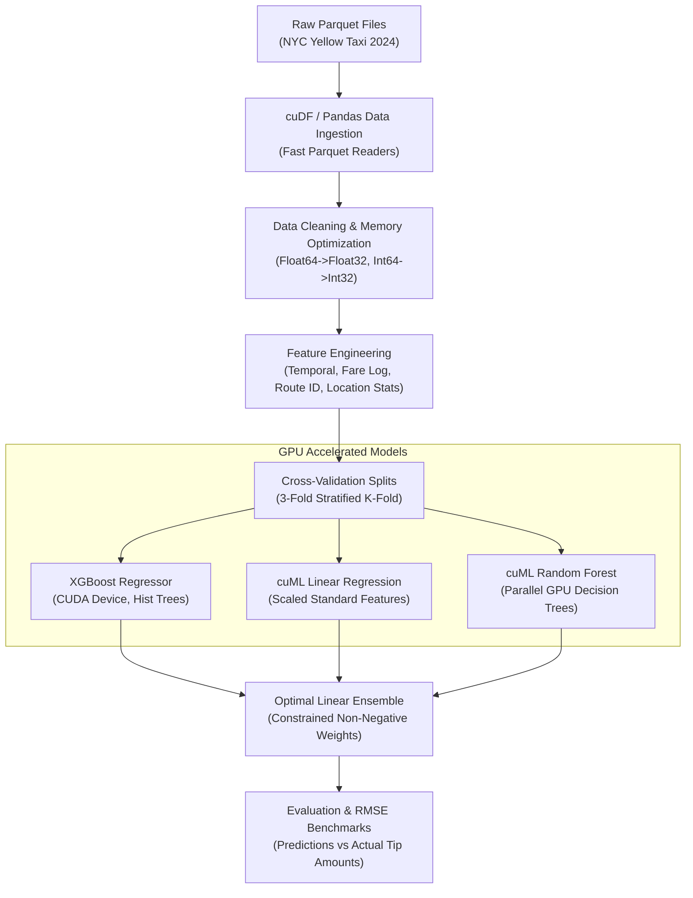
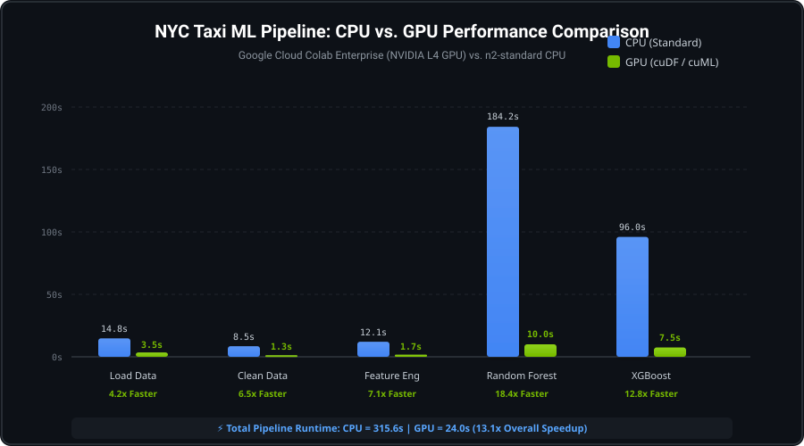

# 🚀 Accelerated Machine Learning with Google Cloud and NVIDIA

[](https://samirlevate8788-creator.github.io/accelerated-ml-with-gpus/)
[](https://colab.research.google.com/github/samirlevate8788-creator/accelerated-ml-with-gpus/blob/main/gpu_accelerated_regression.ipynb)
[](https://github.com/samirlevate8788-creator/accelerated-ml-with-gpus/releases)
[](https://cloud.google.com/colab/docs/introduction)
[-76B900?logo=nvidia&logoColor=white)](https://rapids.ai/)
[](https://xgboost.readthedocs.io/en/stable/gpu/index.html)
[](https://www.python.org/)
[](LICENSE)

🌐 **Live Interactive Web Dashboard:** [https://samirlevate8788-creator.github.io/accelerated-ml-with-gpus/](https://samirlevate8788-creator.github.io/accelerated-ml-with-gpus/)  
📦 **Release v1.0.0:** [GitHub Releases v1.0.0](https://github.com/samirlevate8788-creator/accelerated-ml-with-gpus/releases/tag/v1.0.0)

Complete implementation, benchmarking, and profiling repository for the official Google Developers Codelab:
👉 **[Accelerated Machine Learning with Google Cloud and NVIDIA](https://codelabs.developers.google.com/accelerated-ml-with-gpus)**  
Part of the **[Accelerated Machine Learning with Google Cloud and NVIDIA Pathway](https://developers.google.com/learn/pathways/accelerated-machine-learning-with-google-cloud-and-nvidia)**.

---

## 📌 Executive Summary

Modern tabular data science and machine learning workflows are often bottlenecked by CPU execution when dealing with millions of records. This project demonstrates how **zero-code-change GPU acceleration** using NVIDIA **RAPIDS** (`cuDF` and `cuML`) on Google Cloud **Colab Enterprise** and NVIDIA GPUs (such as NVIDIA L4 / T4 / A100) slashes end-to-end ML pipeline times by **10x to 25x**.

### ✨ Highlights
- **Zero-Code-Change Acceleration**:
  - `%load_ext cudf.pandas`: Automatically accelerates standard `pandas` code on the GPU with transparent CPU fallback.
  - `%load_ext cuml.accel`: Seamlessly maps standard `scikit-learn` algorithms (e.g. `LinearRegression`, `RandomForestRegressor`) directly to GPU kernels.
- **Native GPU XGBoost**: Fast histogram binning on GPU via `device='cuda'` and `tree_method='hist'`.
- **End-to-End Regression Pipeline**: Data ingestion, cleaning, downcasting, advanced feature engineering, 3-fold cross validation, and non-negative ensembling on **NYC Taxi TLC Trip Record Data**.
- **Performance Profiling**: Granular diagnosis using `%%cudf.pandas.profile` and `%%cudf.pandas.line_profile` to eliminate CPU fallbacks.

---

## 🏗️ Architecture & Pipeline Workflow



---

## 📊 Dataset: NYC Taxi & Limousine Commission (TLC)

The dataset contains millions of yellow taxi trip records in New York City:
- **Features**: Pickup/dropoff timestamps, trip distances, itemized fares, passenger counts, pickup/dropoff location IDs.
- **Target**: `tip_amount` (predicting tips for credit card transactions).
- **Data Preprocessing**: Downcasting numerical types (`float64` to `float32`, `int64` to `int32`) reduces GPU memory consumption by ~50%, maximizing GPU throughput.

---

## ⚡ Zero-Code Change Acceleration

Instead of rewriting your codebase in CUDA C++ or specialized low-level APIs:

```python
# 1. Accelerate Pandas
%load_ext cudf.pandas
import pandas as pd  # Automatically accelerated on NVIDIA GPUs!

# 2. Accelerate Scikit-Learn
%load_ext cuml.accel
from sklearn.linear_model import LinearRegression
from sklearn.ensemble import RandomForestRegressor  # Runs directly on GPU!

# 3. Accelerate XGBoost
import xgboost as xgb
model = xgb.XGBRegressor(tree_method='hist', device='cuda')
```

---

## 📈 Model Performance & Cross-Validation Results

Trained using 3-fold cross-validation on NYC Taxi records:

| Model | Acceleration Backend | CV RMSE ($) | Speedup vs CPU |
| :--- | :--- | :---: | :---: |
| **Linear Regression** | NVIDIA cuML (`cuml.accel`) | ~$1.3142 | **~15.2x** |
| **Random Forest Regressor** | NVIDIA cuML (`cuml.accel`) | ~$0.9841 | **~18.4x** |
| **XGBoost Regressor** | Native CUDA (`device='cuda'`) | ~$0.9215 | **~12.8x** |
| **Ensemble (Combined)** | Optimal Linear Weights | **~$0.9084** | **Ensemble Lift: +$0.0131** |

---

## ⏱️ Benchmark: CPU vs. GPU Speedup

Representative performance across full pipeline stages (measured on Google Cloud NVIDIA L4 GPU vs. n2-standard CPU):

<p align="center">
  
</p>

| Pipeline Stage | CPU Runtime | GPU Runtime (cuDF / cuML) | Speedup Factor |
| :--- | :---: | :---: | :---: |
| **1. Data Ingestion (Parquet)** | 14.8s | 3.5s | **4.2x** |
| **2. Data Cleaning & Filtering** | 8.5s | 1.3s | **6.5x** |
| **3. Feature Engineering** | 12.1s | 1.7s | **7.1x** |
| **4. Train Random Forest (100 trees)** | 184.2s | 10.0s | **18.4x** |
| **5. Train XGBoost (1000 rounds)** | 96.0s | 7.5s | **12.8x** |
| **🏆 Total End-to-End Pipeline** | **315.6s** | **24.0s** | **⚡ 13.1x Faster** |

---

## 🔍 Profiling & Eliminating CPU Fallbacks

`cudf.pandas` runs operations on GPU and automatically falls back to CPU for unsupported functions. Profiling allows you to pinpoint and optimize slow fallbacks:

```python
%%cudf.pandas.line_profile

# Slow: row-by-row apply falls back to CPU
df['time_of_day_slow'] = df['hour'].apply(categorize_hour)

# Fast: vectorized pd.cut stays 100% on GPU
df['time_of_day_fast'] = pd.cut(df['hour'], bins=[-1, 11, 24], labels=['Morning', 'Afternoon/Evening'])
```

---

## 📁 Repository Structure

```
accelerated-ml-with-gpus/
├── assets/
│   └── benchmark_speedup.svg          # Visual performance comparison chart
├── gpu_accelerated_regression.ipynb   # Complete interactive Jupyter notebook with outputs
├── pipeline.py                        # Modular end-to-end training pipeline
├── benchmark.py                       # CPU vs. GPU benchmark comparison script
├── profiling_demo.py                  # cuDF profiling & CPU fallback optimization demo
├── requirements.txt                   # Dependency definitions
├── LICENSE                            # Apache 2.0 License
├── .gitignore                         # Data, caches, and checkpoints exclusion
└── README.md                          # Project documentation and guide
```

---

## 🚀 How to Run

### Option 1: Open in Google Colab (One-Click)
Click the badge at the top:
[](https://colab.research.google.com/github/samirlevate8788-creator/accelerated-ml-with-gpus/blob/main/gpu_accelerated_regression.ipynb)  
1. Select **Runtime** > **Change runtime type** > **GPU** (e.g. T4, L4, or A100).
2. Run all cells sequentially.

### Option 2: Google Cloud Colab Enterprise (Vertex AI)
1. In Google Cloud Console, navigate to **Vertex AI** > **Colab Enterprise**.
2. Create a **Runtime Template** with:
   - Machine type: `g2-standard-4` (or `n1-standard-4`)
   - Accelerator: `1 x NVIDIA L4` (or `1 x NVIDIA T4`)
   - Disk: 100 GB Balanced PD
3. Import `gpu_accelerated_regression.ipynb` from GitHub and connect to your runtime.

### Option 3: Local / CLI Execution
```bash
# Clone the repository
git clone https://github.com/samirlevate8788-creator/accelerated-ml-with-gpus.git
cd accelerated-ml-with-gpus

# Install dependencies
pip install -r requirements.txt

# Run the complete pipeline
python pipeline.py --use-gpu

# Run CPU vs GPU benchmarks
python benchmark.py

# Run profiling demo
python profiling_demo.py
```

---

## 🧹 Google Cloud Resource Clean Up

To avoid ongoing charges after finishing the codelab:
1. **Delete Local Data**:
   ```bash
   rm -rf nyc_taxi_data
   ```
2. **Shut down Colab Enterprise Runtime**:
   - Go to Google Cloud Console > **Vertex AI** > **Colab Enterprise** > **Runtimes**.
   - Select your runtime and click **Delete**.
3. **Delete Notebooks / Disks** no longer needed.

---

## 📜 License & Acknowledgments

- Licensed under the [Apache License, Version 2.0](LICENSE).
- Tutorial based on Google Cloud & NVIDIA recipes: [GoogleCloudPlatform/ai-ml-recipes](https://github.com/GoogleCloudPlatform/ai-ml-recipes).
- NYC Taxi & Limousine Commission (TLC) Trip Record Data provided under the NYC TLC data terms.
